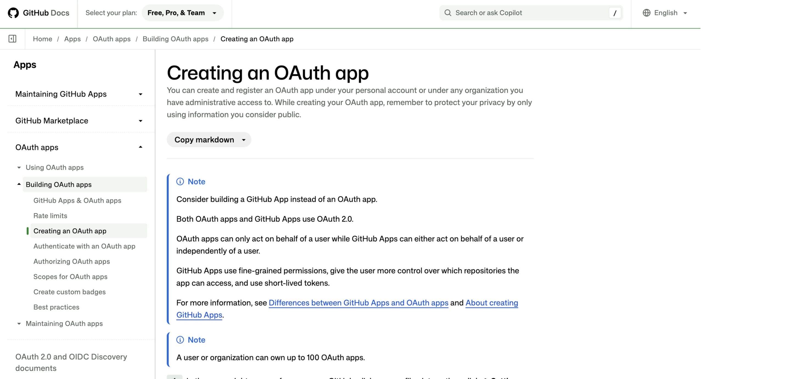
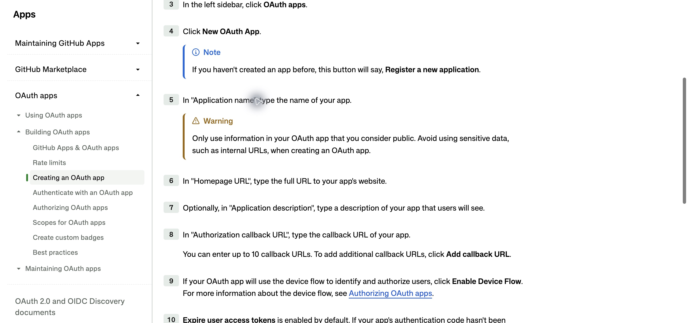
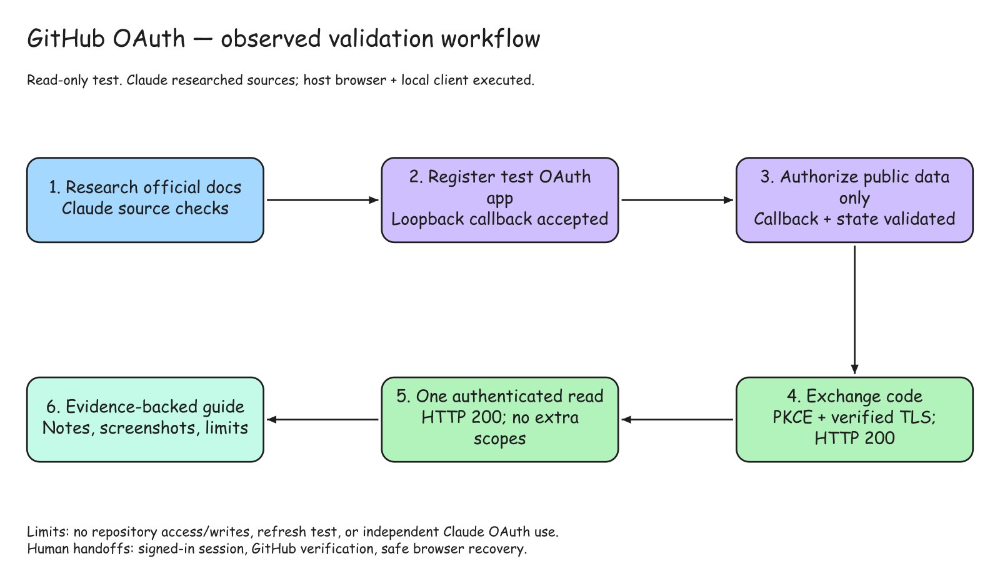

# GitHub OAuth App: setup and validated read-only test

Validated 2026-10-28. **Result: token exchange HTTP 200; exactly one authenticated GET /user HTTP 200; granted scopes empty.** This guide covers an OAuth App, rather than a GitHub App. GitHub recommends considering GitHub Apps for finer permissions and repository selection; this experiment deliberately tested the requested OAuth App route. [Official comparison and setup](https://docs.github.com/en/apps/oauth-apps/building-oauth-apps/creating-an-oauth-app).

The user starts already signed in to GitHub. Signing in does not eliminate later GitHub step-up verification.

## 1. Create the personal OAuth App

Open **Settings → Developer settings → OAuth apps → New OAuth App**. First-time accounts may see **Register a new application**. Use public-safe app metadata. [Official registration steps](https://docs.github.com/en/apps/oauth-apps/building-oauth-apps/creating-an-oauth-app).

For this local test, the host entered:

| Field | Tested value |
|---|---|
| Application name | OAuth Guide validation [identifies this integration to users; in production, use your recognizable product name] |
| Homepage URL | `http://127.0.0.1:8765` [local test only; production example: `https://your-agent.example/`] |
| Description | Private local OAuth setup validation. [optional summary users can see; describe what your integration does; leave blank if unnecessary and never include secrets or internal details] |
| Redirect URI | `http://127.0.0.1:8765/callback` [local test only; production example: `https://your-agent.example/auth/github/callback`] |
| Wildcard matching | Off [broadens allowed redirects to matching subdomains and paths when enabled; keep off for fixed callbacks; enable only if essential and you control every possible matching subdomain and path] |
| Device Flow | Off [lets a CLI or other headless app ask the user to authorize through a code in a separate browser; keep off for this standard web callback flow; enable only when implementing device flow] |
| Expire user access tokens | On; default [issues short-lived access tokens with refresh tokens; ongoing access needs secure token renewal; keep enabled with refresh support; disable only temporarily while updating an older client that cannot refresh] |

**Production values:** replace the example domain with the real deployed website for **your agent application**. Homepage URL is its public landing page; Redirect URI is the actual backend endpoint that receives GitHub's authorization response. The callback path shown is illustrative: implement your chosen endpoint and register its URL according to [GitHub's redirect URL rules](https://docs.github.com/en/apps/oauth-apps/building-oauth-apps/authorizing-oauth-apps#redirect-urls). The OAuth guide website's address is not automatically your agent application's callback. These production examples were not tested; the loopback addresses above are the values validated locally.

**Setting explanations:** [app metadata](https://docs.github.com/en/apps/oauth-apps/building-oauth-apps/creating-an-oauth-app), [wildcard matching and its security conditions](https://docs.github.com/en/apps/oauth-apps/building-oauth-apps/authorizing-oauth-apps#redirect-urls), [device flow](https://docs.github.com/en/apps/oauth-apps/building-oauth-apps/authorizing-oauth-apps#device-flow), and [token expiration and refresh](https://github.blog/changelog/2026-08-14-multiple-redirect-uris-and-token-refresh-for-oauth-apps/). These explain choices; the local test exercised only the recorded values. Wildcards, device flow, and token refresh were not tested.

Click **Register application**. The live page reported **Application created successfully**. The saved loopback URLs were checked. Current UI supports up to 10 redirect URIs. “Private local” is the purpose of this test, not a GitHub OAuth App privacy setting: no private/public distribution toggle was observed.

**Evidence:** previously observed live; no registration screenshot captured. The following screenshots are official documentation, not proof of our registration.

## 2. Obtain the test app's secret securely

The app page showed Client ID and **Generate a new client secret**. Clicking secret generation required GitHub **Confirm access**. The user completed its verification directly in Chrome; no code entered chat. The existing generated secret was then transferred directly inside the browser-control runtime into mode-600 transient local input, without printing it or creating another secret.

**Evidence:** previously observed live; no credential screenshot captured. Secret UI behavior is an observation, not inferred from docs. Keep credentials out of models, chat, URLs and logs. [Official secret-handling guidance](https://docs.github.com/en/apps/oauth-apps/building-oauth-apps/best-practices-for-creating-an-oauth-app).

## 3. Authorize with no extra scopes

The local client bound the exact callback above, generated random state and S256 PKCE, and opened GitHub's authorization endpoint without requesting scopes. The first live consent displayed **Public data only**; host automation accepted the already-authorized read-only request. No repo, organization, email, admin or write permissions were requested.

Validate returned state before exchanging the code. The current GitHub web flow requires the app secret as well as the PKCE verifier; PKCE does not remove that documented requirement. [Official authorization flow](https://docs.github.com/en/apps/oauth-apps/building-oauth-apps/authorizing-oauth-apps).

**Evidence:** consent and callback observed live; no consent screenshot captured. No-scope means public read access, not anonymous access. Prior grants may carry permissions forward, so inspect actual granted scopes. [Scope behavior](https://docs.github.com/en/apps/oauth-apps/building-oauth-apps/scopes-for-oauth-apps).

## 4. Exchange and make one read-only API call

> **TESTED BY VALIDATION AGENT — PASSED**  
> This step was actually executed during our local test on October 28, 2026. The validation agent used browser automation and a local test client to exchange GitHub's temporary authorization code for an access token, then used that token for one read-only account-profile request. Both requests succeeded. No extra permissions were granted and no GitHub content was changed. Claude supplied research and plan checks; host automation executed the test. This result validates our local setup; your deployed application still needs its own test.

**What this step proves:** the tested application could obtain OAuth access and use it for the permitted read. The result does not establish refresh, other API operations, or production readiness. The explanation below records how we reached that result, including the initial certificate issue.

The first callback/state succeeded, but Python's default CA store failed TLS verification before the token endpoint returned HTTP. A credential-free diagnostic verified GitHub with the OS CA bundle. The client then used `/etc/ssl/cert.pem` while retaining certificate and hostname verification. No TLS bypass was used.

A fresh flow reused the same secret and existing consent. Callback/state validated; the fixed code-exchange endpoint returned HTTP 200 and empty granted scopes. The client sent the resulting bearer token for exactly one **GET https://api.github.com/user**, receiving HTTP 200. It recorded only status and identity-shape booleans, never profile fields. [Official exchange and bearer use](https://docs.github.com/en/apps/oauth-apps/building-oauth-apps/authorizing-oauth-apps#web-application-flow).

| Sanitized check | Result |
|---|---|
| Callback received / state valid / PKCE used | true / true / true |
| Token exchange | HTTP 200 |
| Granted scopes | empty |
| Authenticated GET /user | HTTP 200 |
| Expected authenticated identity shape | true |
| API scope header | empty |
| Expiring access token / refresh token returned | true / true |
| Refresh flow tested | false |

The actual completion screenshot below proves the browser reached the query-free local finish page. API proof is the [sanitized result](./result.json), not the screenshot alone.

## 5. Cleanup, attribution and limits

The listener exited and its port was checked closed. Transient credential input and authorization URL file were removed. Access/refresh tokens stayed in process memory and were discarded on exit. The GitHub app, one secret and public-data grant remain; nothing was revoked, deleted or rotated.

Claude fetched official sources, rechecked the flow, and produced sanitized draft notes. Host CUA performed UI actions; the local Python client performed OAuth/API execution. Claude had no connected Chrome session and did not independently use the token. Host review corrected draft wording and attribution; unsupported plan directives in Claude's response were not executed.

| Evidence | File / limitation |
|---|---|
| Live API results | [result.json](./result.json) |
| Test client | [oauth_check.py](./oauth_check.py) |
| Full validation | [report](./validation.md) |
| Earlier registration / consent | Live observed; no screenshot |
| Approval / publishing / org access | Not attempted |

No human action remains for this completed check. Refresh, revocation and production deployment were not tested; timing and approval durations are unknown. A deployed web service does not inherit this host browser session: it needs its own callback and secure per-user execution path. This experiment validates local read-only OAuth, not production service readiness.

## Observed workflow

[Editable Excalidraw workflow](../github-oauth-workflow.excalidraw).
